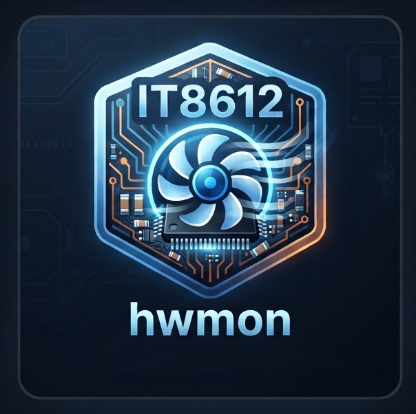

<p align="center">
  
</p>

# it8612 — Linux hwmon driver for the ITE IT8612E

[](LICENSE)
[](https://docs.kernel.org/hwmon/)
[](#tested-hardware)
[](#build-and-install)
[](#the-chip)
[](#safety)
[](https://github.com/EnriquePH/it8612-hwmon/actions/workflows/build.yml)

A small, **read-only** Linux kernel module that reads the temperatures and fan
speeds of the ITE **IT8612E** Super I/O chip, which no Linux driver supports.

## The problem

On boards with an IT8612E, Linux has no fan readings and often no real CPU
temperature:

- `sensors-detect` finds the chip but cannot name it:

  ```text
  Trying family `ITE'...                                      Yes
  Found unknown chip with ID 0x8612
  ```

- The in-kernel [`it87`](https://docs.kernel.org/hwmon/it87.html) driver, and
  the out-of-tree [frankcrawford/it87](https://github.com/frankcrawford/it87),
  do not list ID `0x8612`. `modprobe it87` fails with `No such device`.
- `sensors` shows no fans at all, so a stopped fan goes unnoticed.
- On AMD family 15h CPUs (A-series APUs such as the A8-6500), the only CPU
  sensor, `k10temp`, reports **Tctl**: a control value relative to the
  throttling limit, not degrees. It reads 0 at idle. The real CPU temperature is
  measured by the board's thermistor, wired to the Super I/O.

A common workaround is `modprobe it87 force_id=0x8603`, which treats the chip as
the related IT8603E. It works, but it relies on a test-only parameter, the
driver writes several configuration registers when it loads, and it needs the
IT8603E entry to keep matching the IT8612E.

This driver identifies the IT8612E by its own ID and exposes only what has
been verified on real hardware, without writing to the sensor controller.

## The chip

| | |
| --- | --- |
| Maker | ITE Tech. Inc. |
| Type | LPC Super I/O with hardware monitor ("environment controller") |
| Chip ID | `0x8612` (configuration registers `0x20`–`0x21`) |
| Revision seen | 4 (register `0x22`) |
| Configuration ports | `0x2e`/`0x2f` (also probed: `0x4e`/`0x4f`) |
| Enter key | `0x87 0x01 0x55 0x55` (`… 0xaa` at `0x4e`) |
| Environment controller | Logical device 4; base address in registers `0x60`–`0x61` (e.g. `0x600`); address/data ports at base + 5 / base + 6 |
| Family | ITE IT86xx, register map like the IT8603E and IT8613E |
| Datasheet | Not public (ITE provides it under NDA) |
| Seen on | OEM desktop boards, e.g. HP 2B35 (HP Pavilion 500-526ns, 2015) |

### Registers used

All in the environment controller, read only:

| Register | Content | Exposed as |
| --- | --- | --- |
| `0x29`, `0x2a`, `0x2b` | Temperatures 1–3, signed 8-bit, °C (`0x80` = no sensor) | `temp1_input` … `temp3_input` |
| `0x0d`, `0x0e`, `0x0f` | Fan 1–3 tachometer, low byte | `fan1_input` … `fan3_input` |
| `0x18`, `0x19`, `0x1a` | Fan 1–3 tachometer, high byte | (16-bit counters) |
| `0x13`, bits 4–6 | Fan 1–3 tachometer enabled | hides disabled fans |

Fan speed is `1350000 / (2 × count)` rpm, as in `it87`; a count of `0xffff`
means stopped or not connected.

Fan control is left alone. On the tested board the BIOS sets all three PWM
outputs to the chip's automatic mode (SmartGuardian), driven by temperature 3,
and the chip keeps controlling the fans by itself.

### How the map was established

Without a datasheet, the map was checked on an HP 2B35 board by dumping the
256 registers of the environment controller with `isadump` at rest, under full
load on all CPU cores and while cooling down:

| Register | At rest | 90 s at full load | Cooling down | Reading |
| --- | --- | --- | --- | --- |
| `0x29` | 26 | 38 | 31 | CPU thermistor, °C |
| `0x2a` | 28 | 28 | 28 | Board, °C |
| `0x2b` | 0 | 24 | 4 | Tctl, equal to `k10temp` |
| `0x19:0x0e` | `0x02d4` | `0x02d4` | `0x02d1` | Fan 2, about 935 rpm |
| `0x1a:0x0f` | `0x031a` | `0x0318` | `0x031d` | Fan 3, about 850 rpm |

`it87 force_id=0x8603` gives the same values, and so does this driver.

## What it exposes

Through the standard hwmon interface: `sensors`, `/sys/class/hwmon`, and any
tool built on them, such as Prometheus node_exporter or Grafana.

```text
$ sensors it8612-isa-*
it8612-isa-0600
Adapter: ISA adapter
fan1:           0 RPM
fan2:         944 RPM
fan3:         859 RPM
temp1:        +28.0°C
temp2:        +31.0°C
temp3:         +1.0°C
```

The meaning of each sensor depends on how the board is wired. For the HP 2B35,
[`sensors.d/hp-2b35.conf`](sensors.d/hp-2b35.conf) labels them (copy it to
`/etc/sensors.d/`): temp1 CPU, temp2 Board, temp3 Tctl (relative, not degrees),
fan1 not connected.

> **Tctl is not a temperature.** On AMD family 15h boards, temp3 carries the CPU's
> *Tctl*, a control value relative to the throttling limit (70 on the A8-6500)
> that reads 0 at idle. hwmon reports every `temp*_input` in millidegrees
> Celsius, so `sensors` prints it with `°C`, but it is **not** degrees: use
> temp1 (the CPU thermistor) for the real CPU temperature.

A fan count of `0xffff` reads as **0 rpm** (stopped or not connected); a count
of `0` is not a valid reading and reads as **N/A** (no data), as in `it87`.

## Safety

The driver **never writes** to the environment controller. The only writes are
the standard Super I/O configuration-space sequence used once at load time to
find the controller (enter key, logical device select, exit), the same one
`sensors-detect` and `it87` use. It does not touch fan speed, PWM or alarms.

## Build and install

Requirements: kernel headers and, for automatic rebuilds on kernel updates,
DKMS. On Debian/Ubuntu:

```bash
sudo apt install linux-headers-$(uname -r) dkms build-essential
```

Build and try it:

```bash
make build
sudo rmmod it87 2>/dev/null   # it87 with force_id would hold the same ports
sudo insmod ./it8612.ko
sensors it8612-isa-*
```

Install with DKMS and load it at boot:

```bash
sudo make dkms-install
echo it8612 | sudo tee /etc/modules-load.d/it8612.conf
```

If you used the `it87 force_id` workaround, remove its configuration (for
example the `options it87 force_id=…` line in `/etc/modprobe.d/`).

Upgrade to a new release (`dkms-install` removes the previous version first),
then reload the module:

```bash
git pull
sudo make dkms-install
sudo modprobe -r it8612 && sudo modprobe it8612
```

Uninstall: `sudo make dkms-remove` and delete
`/etc/modules-load.d/it8612.conf`.

### Development

`make help` lists the targets. `make check` runs `make lint` (kernel coding style
with `checkpatch.pl`, found in the kernel tree or given with
`CHECKPATCH=/path/to/linux/scripts/checkpatch.pl`) and `make test` (a build with
extra warnings, `W=1`, that fails on any warning). The kernel build itself is
described in `Kbuild`; project settings and targets are in `project.mk`.

## Module parameters

| Parameter | Default | Use |
| --- | --- | --- |
| `force_id` | 0 | Treat another ITE chip ID as an IT8612E (testing only) |
| `ignore_resource_conflict` | false | Load even if ACPI claims the controller's ports |

## Troubleshooting

| Symptom | Cause and fix |
| --- | --- |
| `insmod: ERROR: … No such device` | No IT8612E found at `0x2e`/`0x4e`, or its environment controller is disabled or has no base address: check `sudo dmesg \| grep -i it8612`. |
| `ports 0x605-0x606 busy (is it87 loaded?)` | Another driver holds the controller: `sudo rmmod it87` (and remove any `options it87 force_id=…` from `/etc/modprobe.d/`). |
| Fails with a resource conflict | The firmware (ACPI) claims the ports. See the [Disclaimer](#disclaimer) before loading it with `ignore_resource_conflict=1`. |
| A fan is missing | Its tachometer input is disabled in register `0x13`: nothing is connected there, or the BIOS turned it off. |
| A fan shows N/A | The chip returned a count of 0: not a valid reading. |
| Temperatures look swapped or odd | Wiring differs between boards; adapt the labels in `sensors.d/` and please report your board. |
| The module is gone after a kernel update | Install it with `make dkms-install` so DKMS rebuilds it. |

## Tested hardware

| Machine | Board / BIOS | CPU | Kernel | Result |
| --- | --- | --- | --- | --- |
| HP Pavilion 500-526ns | HP 2B35, AMI 80.06 (2015) | AMD A8-6500 | 6.12 (Debian 13) | temp1 CPU, temp2 board, temp3 Tctl; fan2 and fan3 |

Reports from other boards are welcome (see [CONTRIBUTING.md](CONTRIBUTING.md)). Open an issue with the output of
`sensors`, the board model and, if possible, a register dump:
`sudo isadump -y 0x<base+5> 0x<base+6>`.

## Not supported (yet)

- PWM duty cycle and fan control: read-only by design, and the PWM scale is not
  confirmed.
- Voltages: their scaling is unknown, and the tested BIOS sets no limits.

## Disclaimer

This driver is provided **as is, without any warranty**, as stated in sections
11 and 12 of the [GNU General Public License](LICENSE): you use it at your own
risk, and the authors are not liable for any damage, data loss or hardware
failure that may result. In particular:

- It has been tested on **one board only** (see [Tested hardware](#tested-hardware)).
  Other boards may wire the IT8612E differently, so the readings may be wrong
  or mislabelled.
- Loading it writes the standard Super I/O configuration sequence (see
  [Safety](#safety)). This is what `sensors-detect` and `it87` do too, but on
  some systems the firmware (ACPI) also uses these ports: the driver refuses
  to load in that case unless `ignore_resource_conflict` is set, and setting it
  is at your own risk.
- `force_id` makes the driver treat another chip as an IT8612E. Use it only for
  testing, on a chip whose register map you have checked.
- The driver does not control the fans or protect the hardware: do not rely on
  it alone to detect overheating.

If something looks wrong, unload it (`sudo rmmod it8612`) and open an issue
with the output of `sensors` and `dmesg`.

## Citation

If you use this driver in research, teaching or other work, please cite it.
The metadata is in [`CITATION.cff`](CITATION.cff); on GitHub, use
**"Cite this repository"** in the sidebar to get APA or BibTeX.

## License

GPL-2.0-or-later (see [`LICENSE`](LICENSE)). Super I/O access follows
`drivers/hwmon/it87.c` from the Linux kernel.

The logo (`assets/img/it8612-hwmon-logo.jpg`) was generated with Google Gemini.
